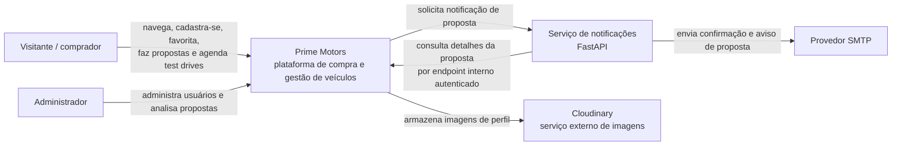
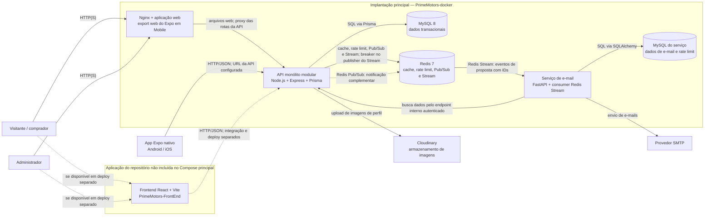
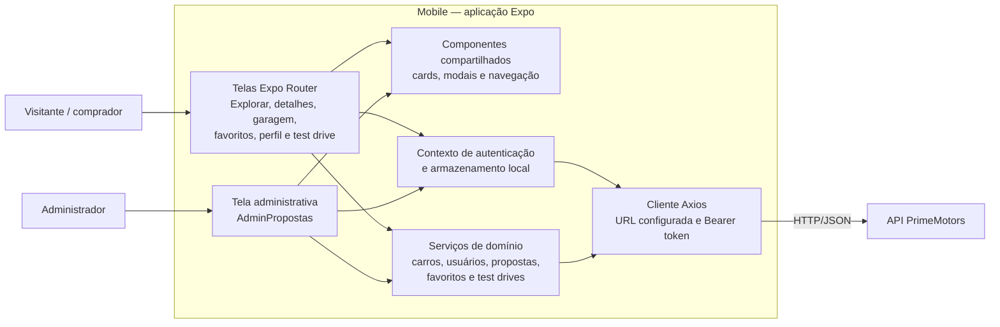
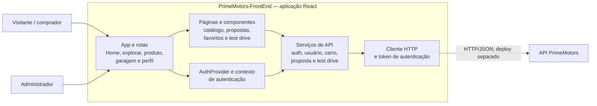
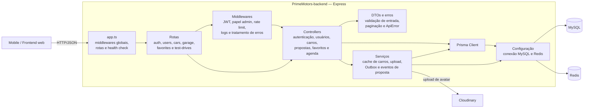
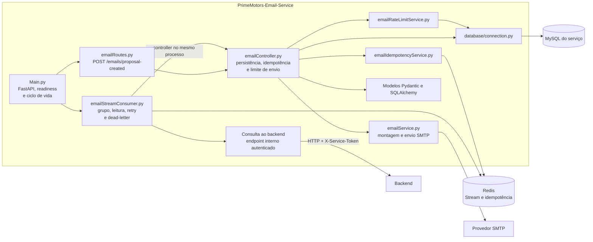
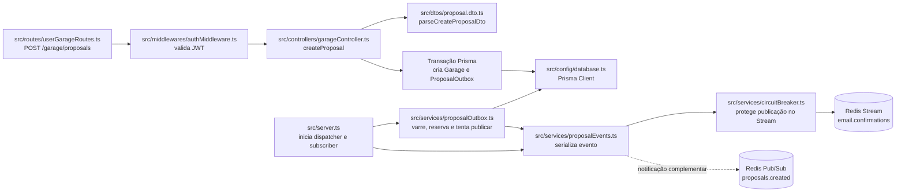
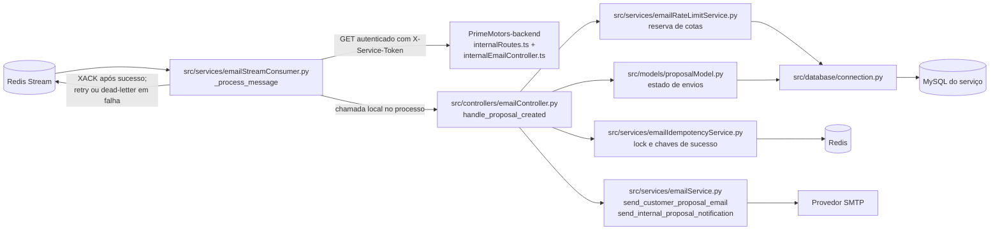

# Arquitetura do sistema — C4

## Escopo

O sistema Prime Motors contém:

- `Mobile`: cliente Expo/React Native, também exportado para web.
- `PrimeMotors-backend`: API TypeScript/Express, Prisma e testes Jest.
- `PrimeMotors-docker`: composição de MySQL, Redis, API e frontend web.
- `PrimeMotors-Email-Service`: API FastAPI para emails de proposta, consumer
  Redis Stream e MySQL próprio. O Compose principal integra backend, Redis,
  consumer/API e banco do serviço; o Compose isolado inicia somente o MySQL do
  serviço. O fluxo de notificações está detalhado em
  [email-service.md](../Services/email-service/email-service.md).

O backend contém módulos de autenticação, usuários, catálogo de veículos,
favoritos, propostas e test drives, mas compartilha processo e banco. A
arquitetura é um **monólito modular**. O serviço de e-mail é um processo
separado. A Outbox e o Redis Stream transportam os eventos de propostas.

## C1 — Contexto

## C2 — Containers

O container `mobile` do Compose é construído a partir de `Mobile`: serve o
export web do Expo com Nginx e encaminha rotas da API ao backend. Nginx e
aplicação web não são containers separados. O app Expo nativo pode ser
executado em dispositivos, mas não é iniciado pelo Compose. O consumer Redis
Stream é uma tarefa em background no processo do serviço FastAPI, não um
container independente. `PrimeMotors-FrontEnd` (React/Vite) é outra aplicação
do repositório e não integra a composição principal.

Na composição principal, a API aguarda MySQL e Redis saudáveis; `mobile` aguarda
a prontidão da API; o serviço de e-mail depende do seu MySQL, Redis e backend.
`GET /health/ready` verifica MySQL e Redis. O Compose descreve uma implantação
em containers, não uma topologia de alta disponibilidade: não define réplicas,
balanceador ou failover de banco.

O publisher da Outbox protege a gravação no Redis Stream com um circuit breaker
por processo: abre após cinco falhas consecutivas, aguarda 30 segundos e permite
uma tentativa de sondagem em estado half-open. A Outbox mantém seu retry
exponencial e retém os eventos até a publicação ser confirmada. O Redis Pub/Sub
é complementar; seu subscriber registra a circulação do evento, enquanto o
consumer do serviço de e-mail processa o Redis Stream.

A API registra requisições em JSON com identificador de correlação, rota,
status e duração. Erros HTTP usam um envelope comum com mensagem, código e
request ID; detalhes internos são enviados aos logs, não à resposta 500.

## C3 — Componentes

Os diagramas abaixo detalham os componentes implementados em cada aplicação.
As setas tracejadas indicam integrações opcionais ou executadas fora do
Compose principal.

### Mobile — Expo / React Native

O cliente Axios centraliza a URL da API e anexa o token de autenticação
armazenado no dispositivo. O mesmo código Expo pode ser exportado para web; no
Compose, o Nginx serve esse export e encaminha as rotas da API.

### Frontend — React / Vite

Este frontend React/Vite é uma aplicação distinta do Mobile e não faz parte da
composição principal. Sua integração com a API depende de configuração e
deploy separados.

### Backend — API monólita modular

As rotas, controllers e serviços executam no mesmo processo Node.js. Prisma é
a camada de acesso ao MySQL; Redis é usado por cache, rate limit e fluxo de
eventos. A rota interna de dados de email autentica o serviço por
`X-Service-Token`, enquanto as rotas de usuário usam JWT e as operações
administrativas também verificam o papel do usuário.

### Serviço de e-mail — FastAPI

O consumer é uma tarefa em background do processo FastAPI, não um container
separado. O endpoint HTTP e o consumer convergem no mesmo controller; o
consumer obtém os dados completos da proposta no backend antes de processar o
evento.

## C4 — Código

Os diagramas C4 abaixo detalham as dependências de código dos fluxos críticos
de propostas e notificações; não representam todas as classes nem substituem a
documentação de cada serviço.

### Backend — criação e publicação da proposta

A proposta e o registro da Outbox são gravados atomicamente. O dispatcher
publica os identificadores no Stream e marca o registro como publicado após
confirmação; em falhas, agenda nova tentativa. Pub/Sub é complementar e não
substitui o Stream consumido pelo serviço de e-mail.

### Serviço de e-mail — consumo e envio

O consumer confirma a mensagem somente depois do processamento bem-sucedido;
falhas transitórias são tentadas novamente e eventos inválidos são enviados à
dead-letter. A idempotência reduz reenvios, mas SMTP e bancos não participam de
uma transação distribuída, portanto o fluxo não garante entrega exactly-once.
