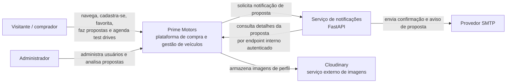
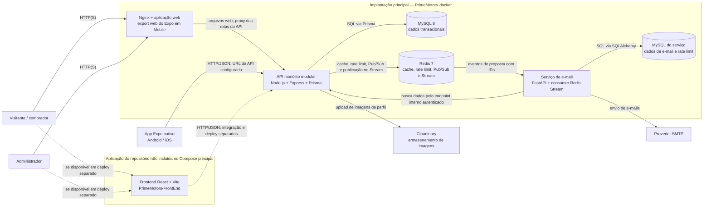

# Arquitetura do sistema — C4

## Escopo e estado atual

Esta documentação foi preparada a partir da estrutura do repositório, dos
serviços Compose, das rotas/controllers Express e do schema Prisma. Ela não
afirma comportamentos além dos observados.

O repositório contém:

- `Mobile`: cliente Expo/React Native, também exportado para web.
- `PrimeMotors-backend`: API TypeScript/Express, Prisma e testes Jest.
- `PrimeMotors-docker`: composição de MySQL, Redis, API e frontend web.
- `PrimeMotors-Email-Service`: API FastAPI para emails de proposta, consumer
  Redis Stream e MySQL próprio. O Compose principal integra backend, Redis,
  consumer/API e banco do serviço; o Compose isolado inicia somente o MySQL do
  serviço. Consulte também [email-service.md](../email-service.md).

O backend contém módulos de autenticação, usuários, catálogo de veículos,
favoritos, propostas e test drives, mas compartilha processo e banco. A
descrição adequada é **monólito modular**, não microserviços independentes. O
Outbox/Redis integra a publicação de eventos de propostas.

## C1 — Contexto

## C2 — Containers

O container `mobile` do Compose é construído a partir de `Mobile`: serve o
export web do Expo com Nginx e encaminha rotas da API ao backend. Nginx e
aplicação web não são containers separados. O app Expo nativo pode ser
executado em dispositivos, mas não é iniciado pelo Compose. O consumer Redis
Stream é uma tarefa em background no processo do serviço FastAPI, não um
container independente. `PrimeMotors-FrontEnd` (React/Vite) é outra aplicação
do repositório e não integra a composição principal.

Na composição principal, a API aguarda MySQL e Redis saudáveis; `mobile` aguarda
a prontidão da API; o serviço de e-mail depende do seu MySQL, Redis e backend.
`GET /health/ready` verifica MySQL e Redis. O Compose descreve uma implantação
em containers, não uma topologia de alta disponibilidade: não define réplicas,
balanceador ou failover de banco.
