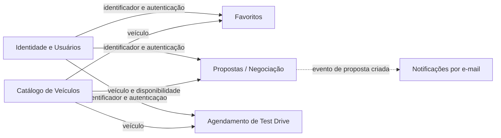

# Domínio e DDD

## Context map inicial

Estes são **subdomínios e contextos conceituais propostos** para organizar o
monólito; não significam que já existam equipes isoladas por contexto. `User`,
`Car`, `Garage` (proposta), `Favorite` e `TestDrive` estão no mesmo schema
relacional do backend. A API de email possui MySQL separado. O backend publica
identificadores no Redis; o consumer busca os dados pelo endpoint interno
autenticado do backend e processa a notificação.

| Subdomínio | Classificação inicial | Responsabilidade |
|---|---|---|
| Catálogo | Core | Consultar carros, marca, categoria, preço, imagens e ficha técnica. |
| Propostas/negociação | Core | Criar e acompanhar ofertas de usuários e decisões administrativas. |
| Identidade e usuários | Supporting | Cadastro, login, perfil, avatar e autorização por papel. |
| Agendamento de test drive | Supporting | Agendar, consultar, alterar e excluir horários de visita. |
| Favoritos | Supporting | Manter a lista de carros salvos e suas anotações. |
| Notificações | Generic/Supporting (a confirmar) | Consumer do Redis Stream processa eventos de propostas; API de email envia confirmação ao usuário e aviso interno. |

## Contexto de Propostas — modelo inicial

O nome físico atual do modelo é `Garage`; no domínio ele representa uma
**Proposta**. O modelo observado é separado abaixo dos Value Objects e
agregados sugeridos, pois o schema Prisma não declara formalmente agregados DDD.

- **Entidade raiz candidata:** `Proposta` (`Garage`): `id`, `userId`, `carId`,
  `offeredValue`, `message`, `date_offer`, `status` e `adminArchived`.
- **Entidades referenciadas:** `User` e `Car`, que permanecem em seus próprios
  contextos; a proposta guarda seus IDs.
- **Value Objects candidatos:** `Money` (valor e moeda BRL, com escala de duas
  casas), `ProposalStatus` (enum já presente) e `ProposalMessage` (texto
  opcional com tamanho máximo a definir). `Money` e `ProposalMessage` são
  conceitos propostos, não classes atualmente implementadas.
- **Agregado candidato:** `Proposta` como raiz, responsável por validar
  transições de status e regras de oferta. A persistência atual também grava
  `ProposalOutbox` na mesma transação ao criar proposta; preservar essa
  atomicidade é requisito para qualquer refatoração.
- **Invariantes observadas:** status inicial `Pendente`; unicidade composta de
  usuário, veículo e status; uma proposta pendente por usuário/veículo é
  verificada pela API e protegida pela restrição correspondente. Regras para
  transições administrativas e limites monetários devem ser formalizadas com
  o negócio.
