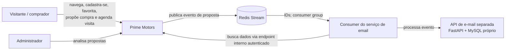
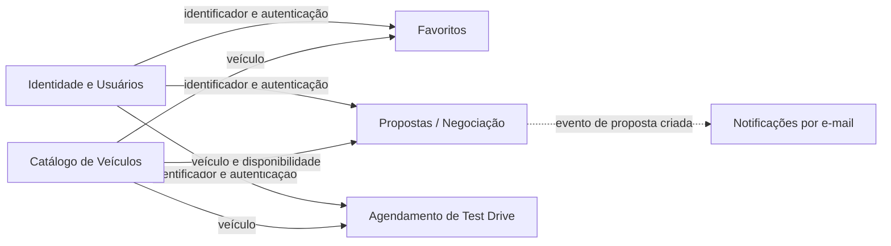

# Prime Motors — arquitetura e atendimento à rubrica

## Escopo e leitura do estado atual

Esta documentação foi preparada a partir da estrutura do repositório, dos
serviços Compose, das rotas/controllers Express e do schema Prisma. Ela não
altera nem afirma comportamentos além dos observados. Os SLOs e passos de
entrega indicados como proposta são metas e recomendações; ainda precisam ser
aceitos, instrumentados e exercitados antes de serem tratados como garantias.

O repositório contém:

- `Mobile`: cliente Expo/React Native, também exportado para web.
- `PrimeMotors-backend`: API TypeScript/Express, Prisma e testes Jest.
- `PrimeMotors-docker`: composição de MySQL, Redis, API e frontend web.
- `PrimeMotors-Email-Service`: API FastAPI separada para emails de proposta,
  com consumer do Redis Stream e MySQL próprio. O Compose principal integra
  backend, Redis, consumer/API e banco do serviço. O Compose isolado do serviço
  ainda inicia somente seu MySQL. O fluxo e os passos operacionais estão em
  [`email-service.md`](./email-service.md).

O backend possui módulos de autenticação, usuários, catálogo de veículos,
favoritos, propostas e test drives, mas todos compartilham um processo e um
banco. A descrição adequada hoje é **monólito modular**, não microserviços
independentes. O outbox/Redis integra a publicação de eventos de propostas.

## 1. Arquitetura: C4 inicial

### C1 — Contexto



### C2 — Containers

```mermaid
flowchart LR
  cliente[Mobile / Web<br/>Expo + React Native]
  nginx[Nginx<br/>conteúdo web e proxy]
  api[Backend<br/>Node.js + Express + Prisma]
  mysql[(MySQL 8<br/>dados transacionais)]
  redis[(Redis 7<br/>cache, rate limit, eventos)]
  consumer[Consumer Redis<br/>no serviço de email]
  consumidor[API de e-mail<br/>FastAPI]
  emailMysql[(MySQL do serviço<br/>propostas e rate limit)]

  cliente -->|HTTP(S), JSON| nginx
  nginx -->|/API| api
  cliente -.->|API URL direta no modo local| api
  api -->|SQL via Prisma| mysql
  api -->|cache, limites, Pub/Sub e Stream| redis
  redis -->|evento contém apenas IDs| consumer
  consumer -->|busca payload pelo backend| api
  consumer -->|controller e SMTP| consumidor
  consumidor -->|SQL| emailMysql
```

No Compose principal, a API aguarda os health checks de MySQL e Redis; o
frontend aguarda a prontidão da API. O endpoint `GET /health/ready` verifica
MySQL e Redis. O Nginx entrega o build web e encaminha as chamadas de API. Isso
descreve uma implantação em containers, não uma topologia de alta
disponibilidade: o Compose observado não define réplicas, balanceador ou
failover de banco.

### ADRs iniciais

| ADR | Decisão documentada | Motivo / consequências |
|---|---|---|
| ADR-001 | Manter inicialmente um monólito modular Express, com módulos por domínio. | As rotas, controllers e serviços estão no mesmo backend e compartilham dados/transações. Evita o custo operacional de separar serviços antes de haver necessidade comprovada. A separação exige limites de módulo e interfaces explícitas. |
| ADR-002 | Usar MySQL como fonte transacional e Prisma como camada de persistência. | O schema Prisma define relações, unicidade e enums; as migrations existentes e a configuração do Compose são MySQL. O adaptador aceita URLs `mysql://` e `mariadb://`. Consequência: migrations e backups precisam ser geridos para MySQL compatível. |
| ADR-003 | Usar Redis para cache de leitura, rate limiting e integração assíncrona de propostas. | Há cache-aside de carros com TTL configurável, limite de requisições e Redis Stream/Outbox. Redis não substitui MySQL como fonte de verdade. A API atual falha fechada no rate limiter quando Redis indisponibiliza e falha aberta no cache de leitura. |
| ADR-004 | Registrar proposta e evento Outbox na mesma transação e publicar depois no Redis Stream. | Evita confirmar proposta sem registrar a intenção de notificar. Dispatcher usa lease e retry exponencial. O consumer do serviço lê o evento com IDs, busca o payload por rota interna autenticada e processa o email. Usa consumer group, recuperação de pendências e `XACK` após sucesso; ver [`email-service.md`](./email-service.md). |

ADRs são registros iniciais inferidos do código e das configurações atuais. A
equipe deve aprová-los e mantê-los conforme a arquitetura evoluir.

## 2. Estilos arquiteturais e DDD

### Context map inicial (limites lógicos sugeridos)



Estes são **subdomínios e contextos conceituais propostos** para organizar o
monólito; não significam que já existam equipes isoladas por contexto.
`User`, `Car`, `Garage` (proposta), `Favorite` e `TestDrive` estão no mesmo
schema relacional do backend. A API de email possui MySQL separado. O backend
publica os identificadores no Redis; o consumer busca os dados pelo endpoint
interno autenticado do backend e processa a notificação.

| Subdomínio | Classificação inicial | Responsabilidade |
|---|---|---|
| Catálogo | Core | Consultar carros, marca, categoria, preço, imagens e ficha técnica. |
| Propostas/negociação | Core | Criar e acompanhar ofertas de usuários e decisões administrativas. |
| Identidade e usuários | Supporting | Cadastro, login, perfil, avatar e autorização por papel. |
| Agendamento de test drive | Supporting | Agendar, consultar, alterar e excluir horários de visita. |
| Favoritos | Supporting | Manter a lista de carros salvos e suas anotações. |
| Notificações | Generic/Supporting (a confirmar) | Consumer do Redis Stream processa eventos de propostas; API de email envia confirmação ao usuário e aviso interno. |

### Contexto de Propostas — modelo inicial

O nome físico atual do modelo é `Garage`; no domínio ele representa uma
**Proposta**. A lista abaixo diferencia o modelo observado das Value Objects e
agregados sugeridos, pois o schema Prisma não declara formalmente agregados DDD.

- **Entidade raiz candidata:** `Proposta` (`Garage`): `id`, `userId`, `carId`,
  `offeredValue`, `message`, `date_offer`, `status` e `adminArchived`.
- **Entidades referenciadas:** `User` e `Car`, que permanecem em seus próprios
  contextos; a proposta guarda seus IDs.
- **Value Objects candidatos:** `Money` (valor e moeda BRL, com escala de duas
  casas), `ProposalStatus` (enum já presente) e `ProposalMessage` (texto
  opcional com tamanho máximo a definir). `Money` e `ProposalMessage` são
  conceitos propostos, não classes atualmente implementadas.
- **Agregado candidato:** `Proposta` como raiz, responsável por validar
  transições de status e regras de oferta. A persistência atual também grava
  `ProposalOutbox` na mesma transação ao criar proposta; preservar essa
  atomicidade é requisito para qualquer refatoração.
- **Invariantes observadas:** status inicial `Pendente`; unicidade composta de
  usuário, veículo e status; uma proposta pendente por usuário/veículo é
  verificada pela API e protegida pela restrição correspondente. Regras para
  transições administrativas e limites monetários devem ser formalizadas com
  o negócio.

## 3. Integração, APIs e dados

A especificação OpenAPI 3.1 com as rotas observadas está em
[`openapi.yaml`](./openapi.yaml). Inclui operações da API, autenticação Bearer
quando aplicável e esquemas básicos de requisição. Deve ser atualizada junto
das rotas e validada em CI quando esse pipeline for criado.

### ADR do banco de dados

O projeto usa MySQL 8 no Compose e Prisma para acesso relacional. O schema tem
relações entre usuários, carros, categorias, marcas, favoritos, propostas e
test drives; também usa constraints de unicidade e migrations versionadas.
Essa escolha permite transações e integridade referencial para operações como
gravar uma proposta e sua linha Outbox atomicamente. Redis é complementar:
cache, rate limiting e transporte de eventos, não a persistência principal.

**Consequências e decisões pendentes:** definir política de backup e teste de
restauração; retenção e monitoramento do Outbox/Stream; aplicar migrations em
deploy com estratégia compatível; medir volume, concorrência e latência antes
de alterar o banco. A configuração presente não demonstra replicação,
failover ou recuperação de desastre.

## 4. Atributos de qualidade, resiliência e observabilidade

### SLOs/SLIs propostos (não medidos nem garantidos atualmente)

As metas gerais de disponibilidade, latência e Core Web Vitals estão
centralizadas em
[`QUALITY_RESILIENCE_OBSERVABILITY.md`](../QUALITY_RESILIENCE_OBSERVABILITY.md)
para evitar definições conflitantes. Elas são propostas, ainda não medidas nem
garantidas. Instrumentar e estabelecer uma linha de base antes de assumir esses
objetivos.

| SLI adicional | SLO inicial sugerido | Como medir |
|---|---|---|
| Publicação de evento de proposta | 99% publicados em até 1 minuto | Tempo entre criação do Outbox e `publishedAt`; contar pendências e retries. |

### Resiliência já observada

- Health checks de MySQL, Redis, API e frontend no Compose; API sinaliza
  readiness após consultar MySQL e Redis.
- Reinício dos containers configurado como `unless-stopped`.
- Cache de carros com TTL de 300 segundos por padrão. Falha de leitura de cache
  recorre ao MySQL; falha de escrita no cache é registrada sem impedir a
  resposta da leitura.
- Rate limit distribuído no Redis; se Redis falha, a API retorna `503` para
  aquela requisição (comportamento fail-closed).
- Outbox com lease, tentativas e backoff exponencial (máximo de 15 minutos);
  Stream com limite aproximado de 10.000 eventos e retenção de 30 dias.
- A API do serviço de email persiste a proposta, mantém limite distribuído de
  envios no MySQL próprio e registra separadamente o estado dos dois emails.
  O consumer usa `XACK` após sucesso, com reprocessamento de pendências. A
  garantia é at-least-once, não exactly-once; consultar
  [`email-service.md`](./email-service.md).
- Encerramento gracioso do servidor fecha o HTTP server e conexões Prisma/Redis.

### Lacunas / estratégia recomendada

- Não há evidência de timeout explícito para operações HTTP de saída ou
  circuit breaker; adicionar deadlines por dependência e circuit breaker apenas
  para chamadas remotas suscetíveis a falhas, com limites e testes.
- Definir o que acontece quando MySQL ou Redis ficam indisponíveis e alertar
  sobre falhas de readiness; não tratar retry como solução para falhas
  permanentes.
- Validar a operação do consumer de email: alertar sobre pendências antigas e
  eventos na dead-letter; executar testes de falha/recuperação em integração.
  O fluxo está implementado, mas precisa de validação end-to-end com Redis,
  MySQL e SMTP do ambiente alvo.
- Rever retenção/limite do Stream com base em volume, latência do consumidor e
  janela de recuperação; acompanhar Outbox pendente e eventos mais antigos.
- Aplicar timeout nas requisições entrantes e limites de payload; revisar
  configuração de proxies e timeouts do Nginx para produção.

### Plano mínimo de observabilidade

- **Métricas:** requisições por rota/status; latência p50/p95/p99; erros 5xx e
  429; readiness; conexões e latência MySQL/Redis; cache hits/misses; limite de
  conexões; volume e idade do Outbox pendente; tentativas/falhas de publicação;
  tamanho e atraso do consumer group; saúde do Nginx e uso de CPU/memória.
- **Logs estruturados:** timestamp UTC, nível, serviço/ambiente, rota,
  método/status, duração, request/correlation ID, `eventId` e erro resumido.
  Não registrar senhas, tokens JWT, CPF, e-mail ou conteúdo de propostas.
- **Alertas iniciais:** readiness indisponível por 2 minutos; taxa 5xx > 5% em
  5 minutos com volume mínimo; p95 acima do SLO por 10 minutos; Outbox mais
  antigo que 5 minutos; crescimento contínuo de retries; falha/atraso do
  consumidor acima da janela definida.
- **Implementação:** logs de containers já vão para stdout/stderr com rotação
  Docker configurada; isso não substitui agregação centralizada, métricas,
  dashboards, tracing ou alertas. Selecionar e configurar essas ferramentas é
  uma etapa operacional ainda pendente.

## 5. Entrega contínua e CI/CD

### Estado observado

O backend oferece `npm test`, `npm run lint` e `npm run build`; os hooks Husky
executam testes em commit e push. O workflow
[`ci-cd.yml`](../.github/workflows/ci-cd.yml) executa esses testes, valida o
OpenAPI e constrói a imagem do backend em pull requests e pushes para qualquer
branch. O job de deploy é manual, depende do sucesso da validação e do
ambiente protegido `production`; sincroniza apenas arquivos versionados
(excluindo certificados) e executa `docker compose up --build -d --wait`.

Para habilitar o deploy, configure no ambiente GitHub `production` as variáveis
`DEPLOY_HOST`, `DEPLOY_USER` e `DEPLOY_PATH` (caminho absoluto no servidor), e
os secrets `DEPLOY_SSH_PRIVATE_KEY` e `DEPLOY_KNOWN_HOSTS`. O host precisa ter
Docker com Compose v2 e acesso SSH; crie previamente nesse caminho
`PrimeMotors-docker/.env` e `PrimeMotors-backend/.env` com valores próprios e
válidos. Os arquivos `.env` não são transferidos pelo workflow. Configure as
regras de aprovação do environment `production` antes de usar em produção.
Nenhum servidor, segredo ou credencial de deploy é presumido ou incluído no
repositório.

### Fluxo de entrega

1. Em pull requests e pushes, instalar dependências do backend, gerar o cliente
   Prisma, executar testes, lint, build, validação OpenAPI e build da imagem
   Docker.
2. Para deploy, executar manualmente o workflow com `deploy: true`; a aprovação
   do environment `production` pode exigir revisão humana.
3. O host compila e atualiza os serviços Compose e aguarda os health checks.
   Verificar também leitura do catálogo e fluxos controlados após o deploy.
4. Executar migrations compatíveis antes de ativar código que dependa delas.
   Preferir mudanças expand/contract para permitir reversão da aplicação.

**Comandos executados no job de validação do backend:**

```sh
npm ci
npx prisma generate
npm test -- --runInBand
npm run lint
npm run build
```

Executar na pasta `PrimeMotors-backend`; o ambiente de CI deve fornecer as
variáveis necessárias de forma segura, sem apontar para dados de produção nos
testes.

### Estratégia de deploy e rollback

O workflow atual reconstrói os serviços no host pelo Compose; ele não publica
imagens em registry nem implementa rollback automático. Antes de um deploy,
registrar o commit e versão de schema atuais; verificar readiness e smoke tests
após a atualização. Se houver falha, retornar o código ao commit anterior e
reconstruir os serviços somente se o schema continuar compatível. Rollback de
código não desfaz migrations destrutivas: usar alterações compatíveis e plano
separado de restauração/roll-forward. Blue/green requer duas pilhas e
roteamento que o Compose atual não configura.

## Runbook curto: API indisponível

1. Confirmar incidente, horário, ambiente e impacto; consultar monitoramento e
   logs dos serviços. Não publicar tokens, dados pessoais ou segredos no ticket.
2. Verificar containers e estado:

   ```sh
   docker compose ps
   docker compose logs --tail=200 backend db redis mobile
   ```

3. Consultar `GET /health/ready` localmente. Se falhar, verificar primeiro
   MySQL e Redis (`health` nos containers, conectividade e espaço em disco);
   depois consultar o erro de inicialização e logs da API.
4. Se houver deploy recente, comparar versão da imagem e migrations. Reverter
   para a última imagem conhecida como saudável se o problema for da aplicação
   e o schema continuar compatível. Não remover volumes para tentar recuperar
   serviço.
5. Se o problema for MySQL, preservar volume e evidências; envolver responsável
   por banco e restaurar backup somente conforme procedimento aprovado.
   Se Redis falhar, considerar que leitura de carros pode usar MySQL, mas
   rate-limited endpoints podem retornar `503`; acompanhar cache e Outbox antes
   de reiniciar ou limpar dados.
6. Validar readiness, uma leitura de catálogo e fluxo de escrita controlado;
   verificar erros e atrasos do Outbox/Stream. Registrar causa, duração,
   impacto, ações e prevenção.

## Resumo de atendimento à rubrica

| Item | Situação |
|---|---|
| Diagramas C4 Contexto e Containers | Documentados acima como diagramas iniciais. |
| ADRs de decisões principais | Documentados como ADRs iniciais a serem aprovados. |
| Qualidade: desempenho/disponibilidade | SLOs propostos; ainda sem evidência de medição/garantia. |
| Context map e subdomínios | Proposta conceitual alinhada aos módulos e schema observados. |
| Bounded Contexts e elementos DDD | Contexto de Propostas descrito; Value Objects/agregado são candidatos, não classes implementadas. |
| OpenAPI/Swagger | Especificação incluída em `openapi.yaml`; conferir e evoluir junto da API. |
| ADR da escolha de banco | Decisão e consequências documentadas acima. |
| Resiliência | Parte implementada; timeouts/circuit breaker e consumidor resiliente são lacunas propostas. |
| Observabilidade | Plano documentado; instrumentação centralizada e alertas ainda pendentes. |
| CI/CD | Workflow executável para testes, lint, build, validação OpenAPI e build Docker; deploy manual protegido e configurável por secrets/vars. |
| Deploy/rollback | Deploy Compose manual implementado; rollback é procedimento documentado, sem automação. Blue/green não está configurado. |
| Runbook | Procedimento inicial para indisponibilidade da API incluído. |
