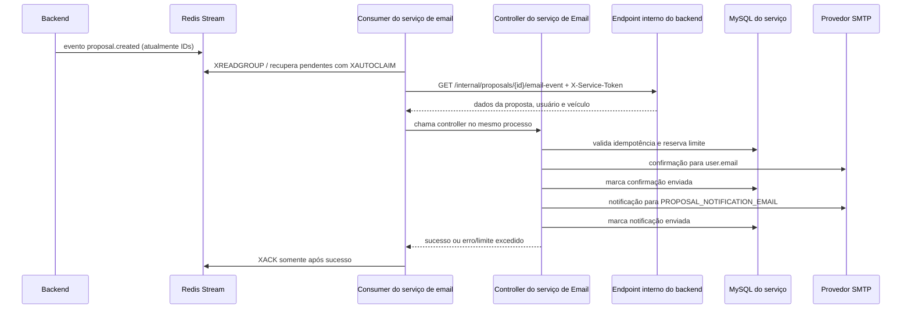

# Serviço de e-mail

Este documento descreve o fluxo Redis de emails, os arquivos envolvidos e como
executar a integração pelo Compose principal.

## O que ele faz

O serviço é uma API FastAPI que recebe `POST /emails/proposal-created` com um
evento `proposal.created`. Depois de autenticar a chamada com
`X-Service-Token`, valida o corpo, guarda a proposta no MySQL próprio e pode
enviar dois emails separados:

1. Confirmação ao endereço `user.email` recebido no evento.
2. Notificação interna para o endereço fixo `PROPOSAL_NOTIFICATION_EMAIL`.

O destinatário do cliente não é um parâmetro livre do app. Ele vem do evento
entre serviços e precisa coincidir com o endereço gravado para aquela proposta
em chamadas repetidas. O modelo valida o formato do email, mas isso não
comprova que a caixa postal pertence ao usuário. Este fluxo confirma uma
**proposta**, não verifica o endereço durante o cadastro.

O endpoint HTTP é usado para chamadas diretas/testes. No fluxo Redis, o consumer
consulta o backend com o token de serviço e chama o controller localmente, sem
fazer uma chamada HTTP para a própria API.

## Fluxo em execução



O consumidor Redis usa o grupo `email-service`. Ele recebe os identificadores
do Stream e consulta o endpoint interno autenticado do backend para montar o
payload completo esperado pelo controller. O evento armazenado no Redis não
contém nome, email, oferta ou outros dados pessoais.

O consumidor chama o controller localmente (não faz uma chamada HTTP para si
mesmo) e confirma (`XACK`) somente após os dois envios constarem como
concluídos. Falhas transitórias permanecem pendentes e são tentadas novamente
com backoff; uma resposta `429` usa `Retry-After`. Mensagens estruturalmente
inválidas ou propostas que não existem são copiadas para
`email.confirmations.dead` (sem dados pessoais) e confirmadas para não bloquear
a fila. Isso proporciona entrega **at-least-once**, não exactly-once: a
idempotência no MySQL evita reenvio depois de um envio marcado, mas uma queda
entre a aceitação SMTP e a gravação dessa marca pode ocasionar duplicidade.

No Compose principal, a API e o consumer Redis rodam no container
`email-service` e o MySQL de email roda separado. O Compose isolado dentro de
`PrimeMotors-Email-Service` continua oferecendo somente MySQL para
desenvolvimento; para executar o fluxo integrado, use o Compose principal.

## Arquivos e responsabilidades

| Arquivo | Responsabilidade |
|---|---|
| `src/Main.py` | Cria a aplicação FastAPI e registra as rotas de email. |
| `src/routes/emailRoutes.py` | Expõe `POST /emails/proposal-created`; compara `X-Service-Token` em tempo constante e responde `401` se ausente ou incorreto. |
| `src/services/emailStreamConsumer.py` | Cria o grupo Redis, lê mensagens novas, recupera pendentes com `XAUTOCLAIM`, consulta o endpoint interno do backend, chama o controller, agenda retry e move eventos inválidos para dead-letter. Só executa `XACK` após sucesso ou dead-letter persistida. |
| `src/models/emailModel.py` | Valida o tipo do evento, os dados da proposta, carro e usuário; `EmailStr` valida o formato do email. |
| `src/controllers/emailController.py` | Orquestra persistência, idempotência, limite de envio, SMTP e respostas HTTP; retorna `429` quando o limite é excedido e registra falhas. |
| `src/services/emailService.py` | Monta e envia duas mensagens independentes via SMTP com STARTTLS: confirmação ao cliente e aviso interno. |
| `src/services/emailRateLimitService.py` | Reserva contadores por destinatário e globais em transação MySQL; usa janela fixa e calcula cota/restante/reset. |
| `src/models/proposalModel.py` | Mapeia propostas e os indicadores de envio de cada uma das duas mensagens. |
| `src/models/emailRateLimitModel.py` | Mapeia a tabela MySQL que guarda contadores de limite usando chaves hash, sem armazenar o email como chave em texto claro. |
| `src/database/connection.py` | Carrega variáveis de ambiente, monta a conexão SQLAlchemy e fornece sessões para os controllers. |
| `PrimeMotors-backend/src/controllers/internalEmailController.ts` | Busca a proposta, usuário e veículo pelo ID e serializa os valores Prisma para o contrato de email. |
| `PrimeMotors-backend/src/routes/internalRoutes.ts` | Protege `GET /internal/proposals/:proposalId/email-event` com comparação em tempo constante do token compartilhado. |
| `PrimeMotors-backend/src/app.ts` | Registra a rota interna autenticada do backend. |
| `migrations/env.py` | Registra os modelos do serviço no Alembic para detectar/aplicar migrations. |
| `migrations/versions/518d48bc11de_create_proposals_table.py` | Migration inicial da tabela `proposals`. |
| `migrations/versions/202611060001_add_email_delivery_limits.py` | Adiciona indicadores de entrega e a tabela `email_rate_limits`. Em instalações com propostas anteriores, os indicadores existentes recebem `1` para evitar reenvios históricos automáticos; as propostas novas começam com `0`. |
| `docker-compose.yml` | Inicia somente o MySQL do serviço para uso isolado; o Compose principal também inicia API/consumer e integra Redis. |
| `Dockerfile` | Instala dependências e inicia a API via `uvicorn src.Main:app`. |
| `.env.example` | Exemplo de configuração de MySQL, SMTP, token de serviço e limites. |
| `requirements-consumer.txt` | Dependências do cliente assíncrono Redis e HTTP para o consumer. |
| `PrimeMotors-docker/docker-compose.yml` | Conecta backend, Redis, API/consumer e MySQL do email na mesma rede interna. |
| `tests/test_email_service.py` | Verifica destinatários distintos para cliente/equipe e rejeição de token incorreto, com SMTP simulado. |
| `README.md` | Resumo de configuração, limites e aplicação de migrations. |

## Limites de envio

Os valores padrão são configurados em `.env.example`:

| Variável | Padrão | Efeito |
|---|---:|---|
| `EMAIL_RATE_LIMIT_PER_RECIPIENT` | 5 | Até cinco confirmações para o mesmo email normalizado por janela. |
| `EMAIL_RATE_LIMIT_GLOBAL` | 100 | Até cem mensagens individuais no total por janela; cada proposta nova pode consumir duas, uma por email. |
| `EMAIL_RATE_LIMIT_WINDOW_SECONDS` | 3600 | Janela fixa de uma hora, alinhada ao relógio Unix. |

O contador global conta apenas mensagens pendentes no momento da tentativa; o
contador por destinatário aplica-se quando ainda falta enviar a confirmação do
cliente. Uma repetição depois de envio parcial consome cota somente para
mensagens ainda pendentes. A reserva é feita antes da chamada SMTP: falhas de
SMTP também consomem cota até o reset da janela.

Em sucesso, a resposta inclui `RateLimit-Limit`, `RateLimit-Remaining`,
`RateLimit-Reset` e `RateLimit-Policy`. Quando o limite é excedido, a API retorna
`429 Too Many Requests`, `Retry-After` e os cabeçalhos de limite. A persistência
no MySQL compartilha os contadores entre réplicas do serviço.

Os indicadores `customer_email_sent` e `notification_email_sent` permitem que
uma chamada posterior tente novamente a mensagem que falhou depois que uma
outra já foi marcada como enviada. Isso não é uma garantia de entrega
"exactly-once": SMTP e banco não participam da mesma transação distribuída, e a
integração chamadora deve controlar reentregas e concorrência.

## Segurança e operação

- Mantenha `SERVICE_TOKEN` forte, fora do app cliente, e compartilhe-o somente
  entre backend/consumer e serviço. A rota não é uma API pública de envio.
- Use credenciais SMTP dedicadas; mantenha TLS habilitado e não grave tokens,
  senhas ou conteúdo sensível em logs.
- O destinatário interno é configurado no servidor. O destinatário do usuário
  vem do evento autenticado entre serviços, não de um campo escolhido pelo app.
- Restrições de frequência são proteção contra abuso, não substituem
  autenticação, autorização do serviço e idempotência.
- O Compose isolado deste diretório oferece apenas MySQL. A API e o consumer
  podem ser executados localmente quando Redis, backend e `SERVICE_TOKEN`
  estiverem configurados; o Compose principal inicia esses componentes juntos.
- A aplicação importa `src.Main` (maiúsculas em `Main`), portanto respeite esse
  nome ao iniciar em Linux, onde caminhos diferenciam maiúsculas de minúsculas.

## Executar localmente

Para executar o fluxo integrado, na pasta `PrimeMotors-docker`:

1. Copie `.env.example` para `.env`. Defina um `SERVICE_TOKEN` aleatório e
   credenciais MySQL/SMTP reais; não use os valores de exemplo em produção.
   Use o mesmo `SERVICE_TOKEN` no `.env` do Compose e em
   `PrimeMotors-backend/.env` ao executar o backend fora do Compose.
2. Inicie o stack integrado:

   ```powershell
   docker compose up -d --build
   ```

   O Compose aguarda MySQL, Redis e backend, aplica as migrations e inicia a
   API/consumer. A API local fica em `http://localhost:8001`; no container, ela
   consulta o backend por `http://backend:3000`.

Para executar a API manualmente, use o Compose principal para manter Redis e
backend acessíveis. Na pasta `PrimeMotors-Email-Service`, crie um venv, instale
`requirements.txt` e `requirements-consumer.txt`, aplique
`alembic upgrade head` e execute `uvicorn src.Main:app --host 0.0.0.0 --port 8000`.
Configure `.env` com `MYSQL_HOST=localhost`, `MYSQL_PORT=3306`,
`EMAIL_REDIS_URL=redis://localhost:6379`,
`BACKEND_API_URL=http://localhost:3000` e o mesmo `SERVICE_TOKEN` do backend.

### Exemplo de chamada

Para teste manual, envie `POST http://localhost:8001/emails/proposal-created` com
`X-Service-Token` configurado no ambiente e o seguinte corpo:

```json
{
  "event": "proposal.created",
  "data": {
    "proposal": {
      "id": "proposal-uuid",
      "offeredValue": "95000.00",
      "message": "Tenho interesse no veículo.",
      "status": "Pendente",
      "createdAt": "2026-11-06T12:00:00"
    },
    "user": {
      "id": "user-uuid",
      "name": "Nome do cliente",
      "email": "cliente@example.com"
    },
    "car": {
      "id": "car-uuid",
      "name": "Modelo do veículo",
      "value": "100000.00"
    }
  }
}
```

O `user.email` recebe a confirmação; `PROPOSAL_NOTIFICATION_EMAIL` recebe o
aviso interno. Uma chamada repetida com a mesma proposta retorna mensagem de
duplicidade se ambos os envios já constarem como concluídos. No fluxo automático,
o consumer obtém esse payload a partir do ID publicado no Redis.
